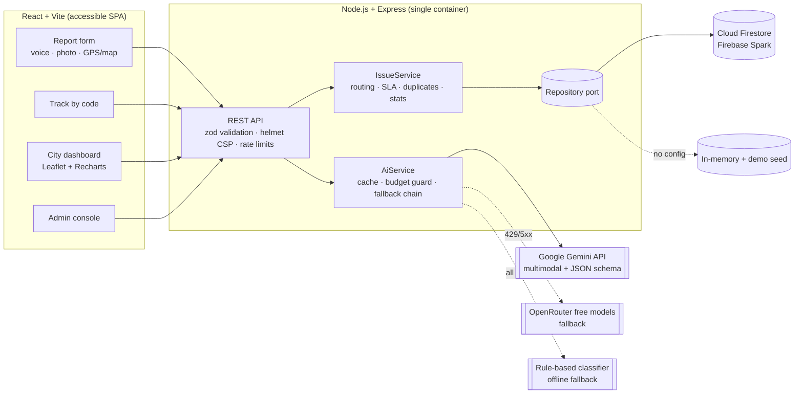

# CivicResolve 🏙️✦

**AI-powered citizen grievance reporting, triage and resolution tracking, built on Google Gemini.**

Citizens report potholes, overflowing garbage, broken streetlights, water leaks and other civic problems in **English, Tamil or Hindi**, by typing or speaking, with an optional photo. **Google Gemini** reads the text and photo together. It then:

- classifies the issue,
- scores its urgency and public impact,
- explains its reasoning,
- recommends the responsible municipal department, and
- flags likely duplicates nearby.

Officials work from a priority-ranked queue with an **AI daily briefing**, and every status change is publicly trackable.

> Built for **PromptWars × GDG on Campus PSG Tech** (Hack2skill).

---

## 📌 Chosen Vertical

* **Challenge Vertical:** Civic Tech / AI-Powered Citizen Grievance Management and Urban Governance.
* **Target Users & Personas:**
  1. **Urban Citizens (Coimbatore / Indian Municipalities):** Need an effortless, multilingual way to report local issues via voice, text, and photos without navigating bureaucratic departmental silos.
  2. **Municipal Commissioners & Field Engineers:** Need an automated, prioritized operational queue with AI safety alerts, automated department routing, and SLA compliance tracking.

---

## 🧠 Approach and Logic

1. **Multimodal AI Vision & NLP:** Rather than manual category dropdowns, citizen complaints are analyzed by **Google Gemini** (`gemini-2.5-flash`) using constrained structured JSON schemas (`responseJsonSchema`) to evaluate description text and evidence photos simultaneously.
2. **Multilingual Inclusivity:** Native support for English, Tamil (`தமிழ்`), and Hindi (`हिन्दी`) via browser Speech-to-Text and Gemini multilingual translation, automatically translating regional inputs to English for municipal officers while maintaining original transcripts.
3. **Dynamic Priority & Impact Scoring (0–100):** Impact scores are dynamically calculated using:
   - Severity and physical hazard tags (e.g., live electrical wires, child/elderly hazard, night-time accident risk).
   - Community support upvotes (preventing duplicate filings by clustering citizens around a single ticket).
   - Time elapsed versus Department Service Level Agreements (SLAs).
4. **Zero-Downtime Fallback Chain:**
   - **Primary:** Google Gemini API (with strict self-imposed RPM/RPD budgets to protect free tiers).
   - **Secondary Fallback:** OpenRouter free tier models if Gemini experiences rate-limits (429) or service degradation.
   - **Offline Tertiary Fallback:** Deterministic heuristic keyword classifier ensuring 100% submission uptime even during network or API outages.

---

## ⚙️ How the Solution Works

1. **Citizen Submission:** Citizen speaks or types in Tamil, Hindi, or English, pins their location on the interactive map or uses GPS reverse-geocoding, and uploads an evidence image.
2. **Instant AI Triage & Duplicate Check:** In real time, Gemini categorizes the issue into one of 12 civic departments, computes urgency and an impact score, and checks for existing nearby complaints within geographic and semantic thresholds (offering citizens the option to "Support" an existing report).
3. **Public Tracking & Transparency:** Citizens receive a unique tracking code (`CR-XXXXXX`) with an SLA countdown, real-time status progression stepper, and 1-click WhatsApp community sharing.
4. **Municipal Operations Console:** Authorized officials log into `/admin` to review prioritized work queues, access Gemini's daily executive briefing, dispatch field teams, and upload resolution proof photos.
5. **Closing the Loop:** The citizen rates the resolution, while the public City Dashboard tracks key performance indicators (KPIs), resolution times, and the AI override rate.

---

## 💡 Assumptions Made

* **Departmental Structure:** Modeled on the standard administrative departments of the Coimbatore City Municipal Corporation (CCMC) and Indian municipal corporations (Public Works, TANGEDCO/Streetlights, Water Supply & Drainage, Health & Sanitation, Town Planning).
* **Citizen Privacy:** Citizen phone numbers and identity details are strictly redacted from all public APIs and dashboards, accessible only to authenticated officers.
* **Connectivity Diversity:** Built with code-splitting, client-side image compression (<300 KB), and local demo dataset fallbacks to ensure smooth operation across 3G/4G mobile networks.

---

## 🎯 Evaluation Focus Areas Alignment

### 1. Problem Statement Alignment (High Impact)
* Accurately addresses citizen frustration with black-box grievance systems by providing instant AI categorization, transparent reasoning ("Why this priority"), and public before/after resolution proofs.
* Multilingual voice and text input democratizes access across socio-economic and linguistic barriers in urban India.
* Open Data CSV export empowers civic researchers and ward committees.

### 2. Code Quality & Architecture (High Impact)
* **Strict TypeScript:** Strict type-safety across both frontend and backend packages with zero `any` shortcuts.
* **Clean Layered Architecture:** Strict separation between HTTP routes, domain entities, service layer (`IssueService`, `AiService`), and repository ports (supporting both Cloud Firestore and in-memory stores).
* **Linting & Formatting:** 100% compliant with ESLint, TypeScript-ESLint, JSX-A11y, and Prettier with zero warnings.

### 3. Security (Medium Impact)
* **API Hardening:** `helmet` CSP headers, per-IP rate limiting, 1.5 MB body parser limits, and control-character sanitization.
* **Admin Authentication:** Constant-time password hashing, cryptographically signed JWT cookies (`httpOnly`, `SameSite=Strict`, `Secure`).
* **Prompt Injection Defense:** Citizen input is strictly isolated within XML encapsulation tags and validated through Zod runtime schema validators before persistence.

### 4. Efficiency & Resource Optimization (Medium Impact)
* **AI Cost & Quota Defense:** Content-hash caching prevents redundant Gemini API calls. Self-imposed RPM/RPD budgets prevent quota exhaustion.
* **Asset Optimization:** Client-side image downscaling (1024px max, WebP/JPEG) and Gzip compression.
* **Bundle Code-Splitting:** Dynamic lazy loading for Leaflet maps and Recharts data visualization.

### 5. Testing & Validation (Low Impact)
* **76 Automated Tests:** Complete Vitest and Supertest suite verifying API endpoints, state transitions, SLA breaches, heuristic fallbacks, and React UI components.
* **Automated Accessibility Testing:** Integrated `axe-core` tests validating WCAG compliance across all primary views.

### 6. Accessibility & Inclusivity (Low Impact)
* Semantic HTML5 landmarks, keyboard navigation skip links, automatic screen-reader focus management on route changes, `aria-live` announcements for dynamic AI results, and high-contrast color ratios.

---

## ✨ Core Features Matrix

| Requirement                   | How CivicResolve delivers it                                                                                                                                                                                                   |
| ----------------------------- | ------------------------------------------------------------------------------------------------------------------------------------------------------------------------------------------------------------------------------ |
| **Citizen issue reporting**   | Title, description, location, category and photo. Location can be typed, taken from GPS (reverse-geocoded) or picked on a map. Voice dictation in English, Tamil and Hindi. Photos are compressed on the device before upload. |
| **AI classification**         | Gemini picks one of 12 civic categories from the text **and the photo** (multimodal), using structured JSON output.                                                                                                            |
| **Priority detection**        | Critical, High, Medium or Low, plus a 0–100 **public impact score**, a list of **hazards** and a plain-language **"why"**. Priorities rise for children, elderly people, night-time danger and busy roads.                     |
| **Department recommendation** | Routes each complaint to one of 12 departments, each with a service-level target in days. Citizens may override the category, and the route follows their choice.                                                              |
| **Issue tracking dashboard**  | Public city dashboard with an interactive map coloured by priority, 14-day trend charts, category and status breakdowns, and 1-click **Export CSV**.                                                                           |
| **Admin dashboard**           | Password-protected console with work queues ranked by AI score, status update editor, AI daily briefings, and 1-click demo access for jury evaluation.                                                                         |

**Beyond the brief**

- 🌐 **Multilingual triage.** Complaints written in Tamil or Hindi are translated to English for officials automatically.
- 🔁 **Duplicate detection.** Nearby similar complaints are matched locally by distance and text similarity, with no extra AI cost. Citizens can **"support"** an existing complaint instead of filing a new one, which raises its priority.
- 🧠 **AI daily briefing.** Gemini summarises open hotspots, safety alerts and today's actions for the commissioner.
- ⭐ **Citizen feedback.** Citizens rate resolved complaints, and the dashboard shows satisfaction and the **AI-override rate**, which keeps the AI accountable.
- 🛡️ **Never-down AI.** If Gemini fails, requests go to OpenRouter (free models), then to an offline rule-based classifier, and the UI labels which engine was used.

## 🧭 Architecture



### How Gemini is used (GenAI services)

1. **Complaint triage:** `POST /api/ai/analyze`.
   - Model: `gemini-2.5-flash` (configurable), called through the official `@google/genai` SDK.
   - Input is the complaint text plus the photo as `inlineData`.
   - Output is constrained with `responseMimeType: application/json` and a `responseJsonSchema` that limits category, priority and department to the allowed values.
   - The prompt treats citizen text as untrusted data inside `<complaint>` tags, which hardens it against prompt injection. Output is then **re-validated with zod** before use.
2. **Admin daily briefing:** `GET /api/admin/briefing`. Gemini reads a compact JSON digest of open issues and returns a headline, hotspots, actions and risk alerts.

### Free-tier quota protection

Gemini's free tier is limited, so the server is careful with it:

| Safeguard               | What it does                                                                                                                           |
| ----------------------- | -------------------------------------------------------------------------------------------------------------------------------------- |
| **Content-hash cache**  | Previewing and then submitting a complaint costs **one** call. Identical concurrent requests are merged into one.                      |
| **Self-imposed budget** | `GEMINI_RPM` / `GEMINI_RPD` caps stay below the real limits. The daily count resets at midnight Pacific, like Google's quota.          |
| **No retry storms**     | SDK retries are disabled. A 429 puts the provider on cooldown, using the server's `retryDelay`, and the next provider is used instead. |
| **Per-IP rate limit**   | AI endpoints allow 6 requests per minute per IP.                                                                                       |
| **Briefing cache**      | The admin briefing is cached for 15 minutes.                                                                                           |
| **Small payloads**      | Images are about 1024 px and 300 KB or less, and prompts are compact.                                                                  |
| **Usage visibility**    | Admins see the remaining daily AI calls in the console (`/api/admin/ai-status`).                                                       |

## ✅ Engineering quality

- **Security**
  - helmet with a strict CSP, rate limiting, and a 1.5 MB body limit.
  - zod validation on every input, an image MIME/size allow-list, and control-character stripping.
  - Admin auth uses a constant-time password check and an `httpOnly` + `SameSite=Strict` + `Secure` JWT cookie.
  - Reporter contact details and voter hashes are **never** returned by public endpoints.
  - Secrets are read only from the environment, and the app refuses to start in production with placeholder secrets.
- **Testing**
  - **75 tests.** The API is covered end to end with supertest, including the full lifecycle, auth, validation and privacy.
  - The AI fallback, cache, budget and cooldown logic, the heuristic classifier, duplicate detection, and React components and pages are tested.
  - Pages are checked for accessibility with **axe-core**.
  - CI runs lint, typecheck, tests and build on GitHub Actions.
- **Accessibility**
  - Skip link, landmarks, focus moved on route change, labelled controls, and inline errors linked with `aria-describedby` and focused.
  - `aria-live` AI results, an accessible meter, a radio-group star rating, and text alternatives for charts.
  - Map data is mirrored as lists, and the app respects reduced motion and dark mode.
- **Efficiency**
  - Pages are code-split by route; the map and charts load lazily.
  - Responses are gzip-compressed and hashed assets are cached as immutable.
  - Firestore list reads are cached for 10 s, and no composite indexes are needed.
- **Code quality**
  - Strict TypeScript, ESLint (typescript-eslint, react-hooks, jsx-a11y) and Prettier.
  - Layered design: routes → services → repository port, with dependency injection for tests.

## 🚀 Run locally

```bash
npm install
cp .env.example .env            # add GEMINI_API_KEY (free: https://aistudio.google.com/apikey)
npm run dev                     # API on :8080, web on http://localhost:5173
```

Without any keys, the app still runs end to end: it uses the offline classifier and an in-memory store seeded with demo complaints from Coimbatore. Try tracking `CR-PSG001`.

| Command                              | Purpose                                                   |
| ------------------------------------ | --------------------------------------------------------- |
| `npm test`                           | Server and client test suites                             |
| `npm run lint` / `npm run typecheck` | Static checks                                             |
| `npm run build && npm start`         | Production build, served from one Node process on `:8080` |

Admin console: `/admin`, using the `ADMIN_PASSWORD` from your `.env`.

## 🧑‍⚖️ Jury Evaluation Guide

### Live Demo
**Deployed URL:** https://civicresolve-4mhe.onrender.com/

### Admin Dashboard Access
| Field    | Value |
| -------- | ----- |
| URL      | https://civicresolve-4mhe.onrender.com/admin |
| Password | `jewqhfbkwyf` *(Also features a 1-click Auto-Fill button on the login screen)* |

### Pre-seeded Demo Complaints (no login needed)
Track any of these live codes at `https://civicresolve-4mhe.onrender.com/track/<code>`:

| Code       | Issue                                          | Status      |
| ---------- | ---------------------------------------------- | ----------- |
| `CR-PSG001` | Exposed live wires at streetlight pole (critical) | In Progress |
| `CR-PSG005` | Open manhole on Race Course walking track     | Resolved ✅ |
| `CR-PSG006` | Traffic signal not working at Lakshmi Mills   | Resolved ✅ |
| `CR-PSG013` | Sewage overflowing into houses at Ukkadam     | Reported 🔴 |
| `CR-PSG015` | Garbage heap blocking lane near Peelamedu     | Resolved ✅ |

### What to evaluate
1. **Report a complaint** at `/report` — type a description, optionally add a photo → AI analysis card shows category, priority, impact score, hazards, reasoning
2. **Admin queue** at `/admin` — priority-ranked complaints, status updates, AI daily briefing button
3. **City dashboard** at `/dashboard` — interactive map, 14-day trend charts, category and status breakdowns
4. **Track page** — search by code, see full timeline with before/after resolution photos
5. **Multilingual** — paste Tamil or Hindi text in the report form; Gemini translates and classifies it

## ☁️ Deploy (free)

See **[docs/DEPLOYMENT.md](docs/DEPLOYMENT.md)** for:

- **Google Cloud Run** (free tier) with **Firestore** on the Firebase Spark plan, or
- **Render** (free web service).

## 📁 Project structure

```
server/   Express API (TypeScript)
  src/domain/        categories, departments, SLAs, status machine
  src/services/ai/   Gemini + OpenRouter providers, prompts, schemas, budget, heuristic fallback
  src/services/      issue service, duplicate detection, priority scoring
  src/repositories/  Firestore + in-memory adapters, demo seed
  src/http/ routes/  validation, auth, rate limits, error handling, routes
client/   React 19 + Vite SPA
  src/pages/         Home, Report, Track, Dashboard, Admin
  src/components/    AI insight card, map, charts, status tracker, photo/voice input
```

## License

MIT
