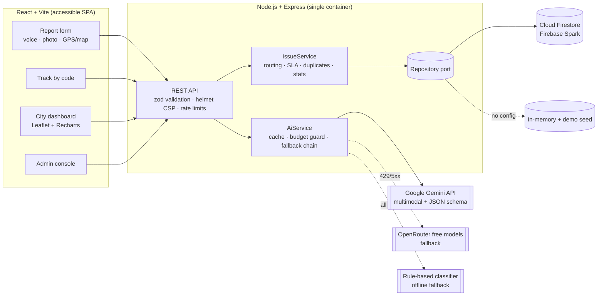

# CivicResolve 🏙️✦

**AI-powered citizen grievance reporting, triage and resolution tracking, built on Google Gemini.**

Citizens report potholes, overflowing garbage, broken streetlights, water leaks and other civic problems in **English, Tamil or Hindi**, by typing or speaking, with an optional photo. **Google Gemini** reads the text and photo together. It then:

- classifies the issue,
- scores its urgency and public impact,
- explains its reasoning,
- recommends the responsible municipal department, and
- flags likely duplicates nearby.

Officials work from a priority-ranked queue with an **AI daily briefing**, and every status change is publicly trackable.

> Built for **PromptWars × GDG on Campus PSG Tech** (Hack2skill).

---

## ✨ Features

| Requirement                   | How CivicResolve delivers it                                                                                                                                                                                                   |
| ----------------------------- | ------------------------------------------------------------------------------------------------------------------------------------------------------------------------------------------------------------------------------ |
| **Citizen issue reporting**   | Title, description, location, category and photo. Location can be typed, taken from GPS (reverse-geocoded) or picked on a map. Voice dictation in English, Tamil and Hindi. Photos are compressed on the device before upload. |
| **AI classification**         | Gemini picks one of 12 civic categories from the text **and the photo** (multimodal), using structured JSON output.                                                                                                            |
| **Priority detection**        | Critical, High, Medium or Low, plus a 0–100 **public impact score**, a list of **hazards** and a plain-language **"why"**. Priorities rise for children, elderly people, night-time danger and busy roads.                     |
| **Department recommendation** | Routes each complaint to one of 12 departments, each with a service-level target in days. Citizens may override the category, and the route follows their choice.                                                              |
| **Issue tracking dashboard**  | Public city dashboard with a map coloured by priority, a 14-day trend, category, status and priority charts, and filterable lists. Each complaint has a tracking code (`CR-XXXXXX`), a progress stepper and a timeline.        |
| **Admin dashboard**           | Password-protected console with a work queue ranked by AI score, upvotes and age. Officials can update status, priority, department and category with a note to the citizen, and see SLA breaches.                             |

**Beyond the brief**

- 🌐 **Multilingual triage.** Complaints written in Tamil or Hindi are translated to English for officials automatically.
- 🔁 **Duplicate detection.** Nearby similar complaints are matched locally by distance and text similarity, with no extra AI cost. Citizens can **"support"** an existing complaint instead of filing a new one, which raises its priority.
- 🧠 **AI daily briefing.** Gemini summarises open hotspots, safety alerts and today's actions for the commissioner.
- ⭐ **Citizen feedback.** Citizens rate resolved complaints, and the dashboard shows satisfaction and the **AI-override rate**, which keeps the AI accountable.
- 🛡️ **Never-down AI.** If Gemini fails, requests go to OpenRouter (free models), then to an offline rule-based classifier, and the UI labels which engine was used.

## 🧭 Architecture



### How Gemini is used (GenAI services)

1. **Complaint triage:** `POST /api/ai/analyze`.
   - Model: `gemini-2.5-flash` (configurable), called through the official `@google/genai` SDK.
   - Input is the complaint text plus the photo as `inlineData`.
   - Output is constrained with `responseMimeType: application/json` and a `responseJsonSchema` that limits category, priority and department to the allowed values.
   - The prompt treats citizen text as untrusted data inside `<complaint>` tags, which hardens it against prompt injection. Output is then **re-validated with zod** before use.
2. **Admin daily briefing:** `GET /api/admin/briefing`. Gemini reads a compact JSON digest of open issues and returns a headline, hotspots, actions and risk alerts.

### Free-tier quota protection

Gemini's free tier is limited, so the server is careful with it:

| Safeguard               | What it does                                                                                                                           |
| ----------------------- | -------------------------------------------------------------------------------------------------------------------------------------- |
| **Content-hash cache**  | Previewing and then submitting a complaint costs **one** call. Identical concurrent requests are merged into one.                      |
| **Self-imposed budget** | `GEMINI_RPM` / `GEMINI_RPD` caps stay below the real limits. The daily count resets at midnight Pacific, like Google's quota.          |
| **No retry storms**     | SDK retries are disabled. A 429 puts the provider on cooldown, using the server's `retryDelay`, and the next provider is used instead. |
| **Per-IP rate limit**   | AI endpoints allow 6 requests per minute per IP.                                                                                       |
| **Briefing cache**      | The admin briefing is cached for 15 minutes.                                                                                           |
| **Small payloads**      | Images are about 1024 px and 300 KB or less, and prompts are compact.                                                                  |
| **Usage visibility**    | Admins see the remaining daily AI calls in the console (`/api/admin/ai-status`).                                                       |

## ✅ Engineering quality

- **Security**
  - helmet with a strict CSP, rate limiting, and a 1.5 MB body limit.
  - zod validation on every input, an image MIME/size allow-list, and control-character stripping.
  - Admin auth uses a constant-time password check and an `httpOnly` + `SameSite=Strict` + `Secure` JWT cookie.
  - Reporter contact details and voter hashes are **never** returned by public endpoints.
  - Secrets are read only from the environment, and the app refuses to start in production with placeholder secrets.
- **Testing**
  - **75 tests.** The API is covered end to end with supertest, including the full lifecycle, auth, validation and privacy.
  - The AI fallback, cache, budget and cooldown logic, the heuristic classifier, duplicate detection, and React components and pages are tested.
  - Pages are checked for accessibility with **axe-core**.
  - CI runs lint, typecheck, tests and build on GitHub Actions.
- **Accessibility**
  - Skip link, landmarks, focus moved on route change, labelled controls, and inline errors linked with `aria-describedby` and focused.
  - `aria-live` AI results, an accessible meter, a radio-group star rating, and text alternatives for charts.
  - Map data is mirrored as lists, and the app respects reduced motion and dark mode.
- **Efficiency**
  - Pages are code-split by route; the map and charts load lazily.
  - Responses are gzip-compressed and hashed assets are cached as immutable.
  - Firestore list reads are cached for 10 s, and no composite indexes are needed.
- **Code quality**
  - Strict TypeScript, ESLint (typescript-eslint, react-hooks, jsx-a11y) and Prettier.
  - Layered design: routes → services → repository port, with dependency injection for tests.

## 🚀 Run locally

```bash
npm install
cp .env.example .env            # add GEMINI_API_KEY (free: https://aistudio.google.com/apikey)
npm run dev                     # API on :8080, web on http://localhost:5173
```

Without any keys, the app still runs end to end: it uses the offline classifier and an in-memory store seeded with demo complaints from Coimbatore. Try tracking `CR-PSG001`.

| Command                              | Purpose                                                   |
| ------------------------------------ | --------------------------------------------------------- |
| `npm test`                           | Server and client test suites                             |
| `npm run lint` / `npm run typecheck` | Static checks                                             |
| `npm run build && npm start`         | Production build, served from one Node process on `:8080` |

Admin console: `/admin`, using the `ADMIN_PASSWORD` from your `.env`.

## 🧑‍⚖️ Jury Evaluation Guide

### Live Demo
**Deployed URL:** https://civicresolve.onrender.com *(replace with your actual URL)*

### Admin Dashboard Access
| Field    | Value |
| -------- | ----- |
| URL      | `<deployed-url>/admin` |
| Password | `jewqhfbkwyf` |

### Pre-seeded Demo Complaints (no login needed)
Track any of these codes at `<deployed-url>/track/<code>`:

| Code       | Issue                                          | Status      |
| ---------- | ---------------------------------------------- | ----------- |
| `CR-PSG001` | Exposed live wires at streetlight pole (critical) | In Progress |
| `CR-PSG005` | Open manhole on Race Course walking track     | Resolved ✅ |
| `CR-PSG006` | Traffic signal not working at Lakshmi Mills   | Resolved ✅ |
| `CR-PSG013` | Sewage overflowing into houses at Ukkadam     | Reported 🔴 |
| `CR-PSG015` | Garbage heap blocking lane near Peelamedu     | Resolved ✅ |

### What to evaluate
1. **Report a complaint** at `/report` — type a description, optionally add a photo → AI analysis card shows category, priority, impact score, hazards, reasoning
2. **Admin queue** at `/admin` — priority-ranked complaints, status updates, AI daily briefing button
3. **City dashboard** at `/dashboard` — interactive map, 14-day trend charts, category and status breakdowns
4. **Track page** — search by code, see full timeline with before/after resolution photos
5. **Multilingual** — paste Tamil or Hindi text in the report form; Gemini translates and classifies it

## ☁️ Deploy (free)

See **[docs/DEPLOYMENT.md](docs/DEPLOYMENT.md)** for:

- **Google Cloud Run** (free tier) with **Firestore** on the Firebase Spark plan, or
- **Render** (free web service).

## 📁 Project structure

```
server/   Express API (TypeScript)
  src/domain/        categories, departments, SLAs, status machine
  src/services/ai/   Gemini + OpenRouter providers, prompts, schemas, budget, heuristic fallback
  src/services/      issue service, duplicate detection, priority scoring
  src/repositories/  Firestore + in-memory adapters, demo seed
  src/http/ routes/  validation, auth, rate limits, error handling, routes
client/   React 19 + Vite SPA
  src/pages/         Home, Report, Track, Dashboard, Admin
  src/components/    AI insight card, map, charts, status tracker, photo/voice input
```

## License

MIT
